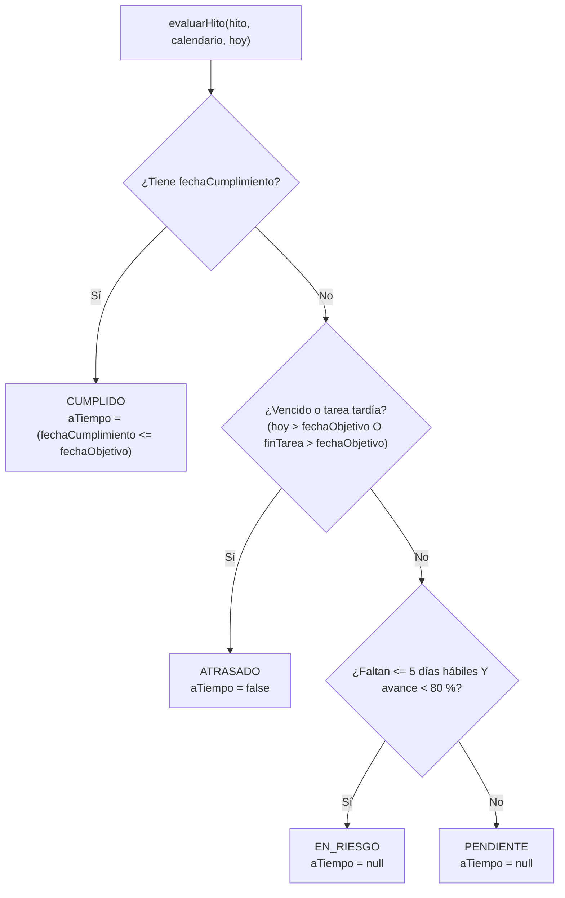

# Módulo de Hitos: Reglas de Estado, Evaluación y Arquitectura

Este documento describe la especificación técnica, modelo de datos, reglas de evaluación y comportamiento del módulo de hitos introducido en el issue #10.

---

## 1. Concepto y Rol en el Proyecto

Un **hito** es un punto de control del proyecto, sin duración estimada ni recursos asignados, que marca el cumplimiento de un objetivo o entrega relevante (por ejemplo, "Acta de inicio aprobada" o "Módulo de órdenes operativo").

En AutoFix Gestión:

- Permite a la jefatura de proyecto y a los interesados seguir el avance global sin auditar cada tarea individual.
- Sirve de base directa para los rombos del diagrama de Gantt (issue #11), las métricas de valor ganado e hitos a tiempo en KPI (issue #14) y el subsistema de alertas preventivas (issue #17).
- El estado del hito se deriva mediante una **función pura** en `packages/core` (`evaluarHito`) y no se edita directamente por ningún rol.

---

## 2. Modelo de Datos y Decisión de Persistencia (D1)

En la base de datos PostgreSQL, la tabla `hitos` almacena exclusivamente los atributos fácticos del hito:

```prisma
model Hito {
  id                Int           @id @default(autoincrement())
  proyectoId        Int           @map("proyecto_id")
  tareaId           Int?          @map("tarea_id")
  nombre            String        @db.VarChar(160)
  criterio          String?
  responsable       String?       @db.VarChar(120)
  fechaObjetivo     DateTime      @map("fecha_objetivo") @db.Date
  fechaCumplimiento DateTime?     @map("fecha_cumplimiento") @db.Date
  proyecto          Proyecto      @relation(fields: [proyectoId], references: [id], onDelete: Cascade)
  tarea             Tarea?        @relation(fields: [tareaId], references: [id], onDelete: SetNull)
  mediciones        KpiMedicion[]

  @@index([proyectoId])
  @@map("hitos")
}
```

### 2.1 Por qué el Estado no se Persiste

Conforme a la decisión **D1**:

1. Los estados **Atrasado** y **En riesgo** dependen dinámicamente de la fecha actual (**hoy**). Un valor persistido en una columna quedaría obsoleto a medianoche sin que medie ninguna transacción, obligando a implementar procesos batch o cron que no aplican a un sistema local monousuario.
2. Persistir el estado generaría dos fuentes de verdad: la columna y la regla de negocio.
3. El estado se calcula al vuelo tanto en consultas `GET` como en respuestas de recálculo (`PasoHitos`), garantizando coherencia absoluta en todo momento.

---

## 3. Reglas de Estado y Precedencia de Evaluación (D2 y D3)

La función `evaluarHito(hito, calendario, hoy)` evalúa el estado siguiendo un orden estricto de precedencia:



### 3.1 Precedencia y Condiciones

| Orden | Estado        | Condición técnica                                                             | Significado                                                                                                              |
| ----- | ------------- | ----------------------------------------------------------------------------- | ------------------------------------------------------------------------------------------------------------------------ |
| 1     | **Cumplido**  | `fechaCumplimiento !== null`                                                  | El JP declaró cumplido el hito. Gana a cualquier atraso proyectado de la tarea vinculada.                                |
| 2     | **Atrasado**  | `hoy > fechaObjetivo` **o** `(finTarea !== null && finTarea > fechaObjetivo)` | El plazo objetivo ya venció en días corridos, o el cronograma proyectado de la tarea vinculada excede la fecha objetivo. |
| 3     | **En riesgo** | `diasHabilesRestantes <= 5` **y** `avance < 80`                               | Faltan 5 días hábiles o menos y el avance de la tarea (o del hito) es menor al 80 %.                                     |
| 4     | **Pendiente** | Cualquier otro caso                                                           | El hito está en curso o programado a futuro dentro de los márgenes tolerables.                                           |

### 3.2 Reglas Específicas y Casos Borde

1. **Atrasado por fecha (días corridos):** La comparación `hoy > fechaObjetivo` se realiza con días corridos (calendario civil). Si la fecha objetivo fue un viernes y se consulta el sábado, `diasHabilesEntre` daría 0, pero el hito está formalmente atrasado. La interfaz muestra "Vencido".
2. **Fin calculado de la tarea vinculada:** Se utiliza `tarea.finPlan`, que en el motor CPM ya integra `finReal` si la tarea comenzó o concluyó.
3. **Cálculo de días hábiles restantes:** Se utiliza `diasHabilesEntre(hoy, fechaObjetivo, calendario)`, el cual contabiliza los días hábiles en el intervalo semiabierto `(hoy, fechaObjetivo]`. Excluye la jornada actual e incluye la fecha objetivo si es día hábil conforme al calendario del proyecto (descontando sábados, domingos y feriados chilenos).
4. **Hitos sin tarea vinculada (D3):** Al no contar con una tarea asociada que certifique avance, su porcentaje de avance se considera preventivamente como `0 %`. En consecuencia, al restar 5 días hábiles o menos para su fecha objetivo, el hito entra en estado **En riesgo**, advirtiendo a la jefatura de proyecto antes del vencimiento.
5. **Cumplimiento y puntualidad (`aTiempo`):** Un hito cumplido expone `aTiempo: boolean`, indicando si `fechaCumplimiento <= fechaObjetivo`. Esta bandera es insumo directo para el indicador de porcentaje de hitos cumplidos a tiempo en el issue #14.
6. **Tareas padre vinculadas:** Si un hito se vincula a una etapa o actividad con hijas, se utilizan sus valores consolidados de `finPlan` y `porcentajeAvance`.
7. **Cumplimiento no automático (D12):** Que la tarea vinculada llegue al 100 % de avance no asigna automáticamente `fechaCumplimiento`. El cumplimiento de un hito requiere una validación de aceptación formal (acta, entrega o inspección) registrada por el Jefe de Proyecto.

---

## 4. Zona Horaria y Determinismo (D4)

Para garantizar determinismo entre el entorno Docker (donde los contenedores ejecutan bajo UTC por defecto) y la hora local chilena:

- La fecha de referencia se obtiene mediante `hoyEnZona(instante, 'America/Santiago')` en `packages/core/src/fechas.ts`, aprovechando la biblioteca ICU integrada en Node.js 22.
- En la API de NestJS, el servicio inyecta la clase proveedora `Reloj`. En producción entrega la fecha real de Santiago de Chile; en pruebas automatizadas se sustituye por una fecha fija (`2026-10-30`), aislando los tests del paso del tiempo.

---

## 5. Integración con el Recálculo (D5)

El pipeline de recálculo transaccional (`PASOS_RECALCULO`) incluye como segundo paso a `PasoHitos`:

1. Tras ejecutar `PasoFechas` (que recalcula fechas tempranas, holguras y criticidad de las tareas), `PasoHitos` consulta los hitos del proyecto y los evalúa contra las tareas actualizadas en memoria.
2. Asigna la lista resultante a `contexto.hitos`.
3. `RecalculoService.ejecutar` retorna `{ arbol, tareasAfectadas, hitos }`.
4. El cliente web almacena inmediatamente la nueva lista en la caché de TanStack Query (`queryClient.setQueryData(['hitos', proyectoId], resultado.hitos)`) y notifica al usuario si algún hito cambió de estado ("Módulo de órdenes: Pendiente → Atrasado").

---

## 6. Auditoría y Eliminación en Cascada (D8 y D9)

- Las operaciones de escritura (`POST`, `PATCH`, `DELETE`) en `/hitos` están restringidas al rol **JP** (`PERMISOS.editarPlanificacion`). La lectura está permitida para **JP** y **CC**.
- Cada mutación registra una fila de auditoría en la tabla `bitacora` (`CREAR`, `ACTUALIZAR` o `ELIMINAR`) con entidad `'Hito'`.
- El cambio de estado por el mero paso del tiempo no genera filas en la bitácora, ya que corresponde a un valor derivado y no a una modificación de datos.
- **Desvinculación por borrado de tarea (D8):** Al eliminar una tarea (o un subárbol completo por eliminación de su padre), `TareasService.eliminar` busca los hitos vinculados a dichas tareas. Antes de confirmar la transacción, registra para cada hito una fila `ACTUALIZAR` con campo `tareaId`, valor anterior `{ id, codigo }`, valor nuevo `null` y origen `Tarea eliminada: <codigo>`.

---

## 7. Conjunto de Datos Semilla y Vencimiento Documentado (D11)

El script de inicialización (`prisma/seed.ts`) incorpora 6 hitos para el proyecto principal "AutoFix · Implementación":

| Hito                             | Tarea vinculada | Fecha objetivo  | Cumplimiento | Estado inicial | Tipo                |
| -------------------------------- | --------------- | --------------- | ------------ | -------------- | ------------------- |
| Acta de inicio aprobada          | —               | 2026-10-30      | 2026-10-29   | Cumplido       | Invariante          |
| Procesos del taller levantados   | 1.1             | 2026-11-06      | —            | Atrasado       | Invariante          |
| Diseño de la solución aprobado   | 1.2             | 2026-11-20      | —            | Pendiente      | Evolutivo           |
| Módulo de órdenes operativo      | 2.1             | 2026-12-04      | —            | Pendiente      | Evolutivo           |
| Sistema en marcha blanca         | 2               | 2027-03-31      | —            | Pendiente      | Invariante temporal |
| Revisión con el dueño del taller | —               | Hoy + 3 hábiles | —            | En riesgo      | Invariante relativo |

### 7.1 Nota de Vencimiento del Seed (2027-03-22)

- El seed verifica de forma determinista únicamente los 4 hitos invariantes (Acta = CUMPLIDO, Procesos = ATRASADO, Marcha blanca = PENDIENTE, Revisión = EN_RIESGO).
- La fecha objetivo del hito "Sistema en marcha blanca" está establecida en el `2027-03-31`. A partir del día **2027-03-23**, restarán 5 días hábiles para dicha fecha y el hito transicionará naturalmente a estado **En riesgo**.
- Si el script `seed` es ejecutado a partir de dicha fecha, la aserción de verificación lanzará un error explícito recordando este comportamiento temporal documentado.
