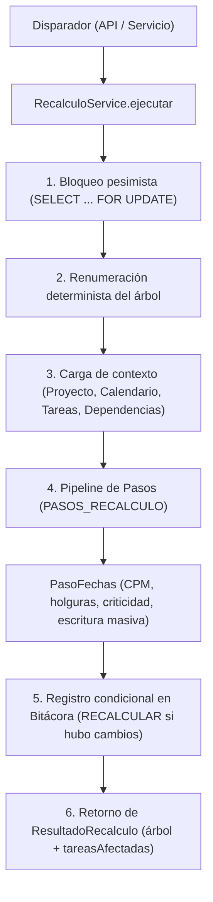

# Servicio de Recálculo Automático y Pipeline de Cronograma

Este documento describe la arquitectura, flujo de ejecución, disparadores, registro de auditoría y extensibilidad del servicio de recálculo automático (`RecalculoService`) introducido en el issue #9.

---

## 1. Arquitectura y Principio Abierto/Cerrado (OCP)

El sistema de recálculo desacopla la orquestación transaccional de los cálculos derivados de dominio mediante un pipeline extensible de pasos secuenciales.



### 1.1 Contexto de Ejecución (`ContextoRecalculo`)

Todos los pasos del pipeline reciben y enriquecen un objeto de contexto único compartido dentro de una misma transacción de PostgreSQL:

- `tx`: Cliente transaccional de Prisma (`Prisma.TransactionClient`).
- `proyecto`: Registro bloqueado del proyecto.
- `calendario`: Instancia inmutable de `CalendarioLaboral`.
- `tareas`: Arreglo de tareas del proyecto cargadas desde la base de datos (actualizadas por cada paso).
- `dependencias`: Arreglo de dependencias entre tareas del proyecto.
- `tareasAfectadas`: Arreglo acumulativo de tareas hoja cuyas fechas planificadas cambiaron.
- `detalle`: Diccionario de metadatos de auditoría para la bitácora (`finProyectoAnterior`, `finProyectoNuevo`, `filasActualizadas`).
- `huboCambios`: Bandera booleana que se activa si algún paso modificó valores en la base de datos.

---

## 2. Flujo de Ejecución Paso a Paso

1. **Bloqueo Pesimista:** Se invoca `obtenerProyectoAbierto(tx, proyectoId, { bloquear: true })`, emitiendo `SELECT ... FOR UPDATE` sobre la fila del proyecto. Esto serializa las operaciones concurrentes de planificación y previene condiciones de carrera.
2. **Renumeración del Árbol:** `ArbolTareasService.numerar(tx, proyectoId)` calcula y actualiza los códigos jerárquicos definitivos (`1`, `1.1`, `1.1.1`) y el orden de hermanas en dos fases con prefijo temporal para respetar la restricción única `(proyecto_id, codigo)`.
3. **Carga de Datos:** Se obtienen el calendario laboral con sus feriados, todas las tareas y dependencias del proyecto.
4. **Ejecución del Pipeline:** Se itera secuencialmente sobre la lista de proveedores inyectados bajo el token `PASOS_RECALCULO`:
   - `PasoFechas`:
     - Invoca `planificarProyecto(...)` de `@autofix/core`.
     - Si se detecta un ciclo, lanza `CicloDetectadoError`, el cual es traducido a `ExcepcionApi(422, 'CICLO_DETECTADO')`, abortando la transacción completa y revirtiendo cualquier cambio previo.
     - Compara los 12 campos de cada tarea antes y después del cálculo.
     - Ejecuta la persistencia masiva en lotes de 1000 filas mediante `UPDATE ... FROM (VALUES ...)` parametrizado (`Prisma.sql` y `Prisma.join`), escribiendo únicamente las filas que cambiaron.
     - Llena `contexto.tareasAfectadas` con las hojas que cambiaron de fecha y ya tenían fecha previa.
     - Marca `contexto.huboCambios = true` si hubo variaciones en fechas, holgura, criticidad o duración.
5. **Auditoría Condicional:** Si `contexto.huboCambios === true`, se registra una única fila en la tabla `bitacora` con acción `RECALCULAR`, entidad `Proyecto`, y un objeto JSON que resume el impacto.
6. **Retorno:** Devuelve `{ arbol: ArbolTareas, tareasAfectadas: TareaAfectada[] }`.

---

## 3. Disparadores y Orígenes Registrados

El recálculo se ejecuta como efecto colateral obligatorio dentro de la misma transacción en todas las mutaciones que afectan la topología, el calendario o las restricciones temporales:

| Mutación / Evento                                | Servicio                                     | Origen registrado en Bitácora                                           |
| ------------------------------------------------ | -------------------------------------------- | ----------------------------------------------------------------------- |
| `POST /proyectos/:id/tareas`                     | `TareasService.crear`                        | `Tarea creada: <codigo>`                                                |
| `PATCH /tareas/:id` (con cambios en cronograma)  | `TareasService.actualizar`                   | `Cambio de <etiquetas> en <codigo>` (ej: `Cambio de duración en 1.1.1`) |
| `PATCH /tareas/:id` (sin cambios en cronograma)  | `TareasService.actualizar`                   | `Edición en <codigo>` (no genera fila `RECALCULAR` al no haber cambios) |
| `POST /tareas/:id/mover`                         | `TareasService.mover`                        | `Tarea movida: <codigo>`                                                |
| `DELETE /tareas/:id`                             | `TareasService.eliminar`                     | `Tarea eliminada: <codigo-previo>`                                      |
| `POST /proyectos/:id/dependencias`               | `DependenciasService.crear`                  | `Dependencia agregada: <P> → <S> (<tipo> [desfase])`                    |
| `DELETE /dependencias/:id`                       | `DependenciasService.eliminar`               | `Dependencia eliminada: <P> → <S> (<tipo> [desfase])`                   |
| `PUT /proyectos/:id/calendario/dias-laborables`  | `CalendarioService.actualizarDiasLaborables` | `Actualización de días laborables`                                      |
| `POST /proyectos/:id/calendario/feriados`        | `CalendarioService.crearFeriado`             | `Feriado agregado: <fecha>`                                             |
| `DELETE /feriados/:id`                           | `CalendarioService.eliminarFeriado`          | `Feriado eliminado: <fecha>`                                            |
| `PATCH /proyectos/:id` (cambio de `fechaInicio`) | `ProyectosService.actualizar`                | `Cambio de fecha de inicio del proyecto: <antes> → <despues>`           |

---

## 4. Estructura de `tareasAfectadas`

El arreglo `tareasAfectadas` informa al cliente frontend exactamente cuáles tareas ejecutables (hojas) sufrieron reprogramación de sus fechas tempranas, permitiendo desplegar alertas contextuales:

```ts
interface TareaAfectada {
  id: number;
  codigo: string;
  inicioAnterior: string; // Formato AAAA-MM-DD
  inicioNuevo: string; // Formato AAAA-MM-DD
  finAnterior: string; // Formato AAAA-MM-DD
  finNuevo: string; // Formato AAAA-MM-DD
}
```

### Reglas de Inclusión

- Solo incluye **tareas hoja** (subactividades o actividades sin subtareas). Las tareas padre se excluyen porque sus fechas son un reflejo consolidado de sus hijas.
- Requiere que la tarea **ya existiera y tuviera fechas calculadas** antes de la operación. Una tarea recién creada no se considera "reprogramada".
- Requiere que al menos una de las fechas (`inicioPlan` o `finPlan`) haya cambiado.
- Ordenada según el orden natural del código jerárquico (`1.1.1` antes de `1.1.2`).

---

## 5. Regla de la Fila `RECALCULAR` en la Bitácora

Para evitar saturar la bitácora con registros individuales por cada tarea movida, el recálculo registra **una única fila consolidada** para todo el evento:

- **Acción:** `RECALCULAR`
- **Entidad:** `Proyecto`
- **Entidad ID:** Identificador numérico del proyecto.
- **Origen:** Descripción contextual provista por el disparador (recortada a 200 caracteres).
- **Detalle (`valorNuevo`):**
  ```json
  {
    "tareasAfectadas": [
      {
        "id": 15,
        "codigo": "2.1.2",
        "inicioAnterior": "2026-11-24",
        "inicioNuevo": "2026-11-26",
        "finAnterior": "2026-12-03",
        "finNuevo": "2026-12-07"
      }
    ],
    "finProyectoAnterior": "2026-12-10",
    "finProyectoNuevo": "2026-12-14",
    "filasActualizadas": 3
  }
  ```

### 5.1 Orden de Inserción y Cronología en Bitácora

En el diseño transaccional de las operaciones con recálculo existe una particularidad en el orden relativo de los identificadores (`id`) de las filas de bitácora:

- **En operaciones `crear` y `mover`:** La fila con `accion = RECALCULAR` tiene un `id` numérico menor (se insertó antes en la base de datos) que la fila con `accion = CREAR` o `accion = ACTUALIZAR` correspondiente a la tarea.
  - **Causa técnica:** `recalculo.ejecutar` debe ejecutarse antes para renumerar deterministamente los códigos jerárquicos del árbol (`1.1`, `1.2`, etc.) y computar el cronograma definitivo. El registro de auditoría `CREAR`/`ACTUALIZAR` de la tarea requiere dicho código jerárquico definitivo en su instantánea (`valorNuevo`), por lo que se emite inmediatamente después del recálculo, antes de confirmar la transacción.
- **En operaciones `actualizar` (edición de campos de una tarea existente):** El orden es el intuitivo: primero se registra `ACTUALIZAR` con los cambios atómicos de los campos editados y posteriormente `RECALCULAR` con el impacto en el cronograma.
- **Visualización en interfaz de usuario:** La bitácora se consulta habitualmente ordenada por `creadoEn DESC, id DESC`. Por ende, en la vista del historial la fila de recálculo puede situarse visualmente encima o debajo del evento de la tarea según la operación ejecutada; esto corresponde estrictamente al diseño transaccional y no a una anomalía.

---

## 6. Cómo Agregar un Paso Futuro al Pipeline

Para incorporar futuros pasos derivados (como cálculo de costos en el issue #13, cálculo de carga de trabajo en el #14 o análisis de impacto en el #17):

1. Crear la clase que implemente la interfaz `PasoRecalculo`:
   ```ts
   @Injectable()
   export class PasoCostos implements PasoRecalculo {
     readonly nombre = 'costos';

     async ejecutar(contexto: ContextoRecalculo): Promise<void> {
       // Consumir contexto.tareas, contexto.tx, etc.
       // Actualizar valores en base de datos si aplica.
       // Activar contexto.huboCambios = true si hubo modificaciones.
     }
   }
   ```
2. Registrar el paso en el factory provider `PASOS_RECALCULO` en `RecalculoModule`:
   ```ts
   {
     provide: PASOS_RECALCULO,
     useFactory: (fechas: PasoFechas, costos: PasoCostos) => [fechas, costos],
     inject: [PasoFechas, PasoCostos],
   }
   ```

No se requiere modificar `RecalculoService`, preservando la integridad del módulo conforme a OCP.

---

## 7. Ejecución de Pruebas de Integración contra PostgreSQL

La verificación de atomicidad, serialización y reversión ante ciclos se ejecuta contra una base de datos real PostgreSQL (`autofix_pruebas`) en el contenedor Docker.

Para ejecutar la suite de pruebas contra base de datos:

```bash
pnpm test:bd
```

Este comando ejecuta Vitest dentro del contenedor de la API apuntando a la base de pruebas, garantizando aislamiento total de la base de desarrollo sin dejar datos residuales.
